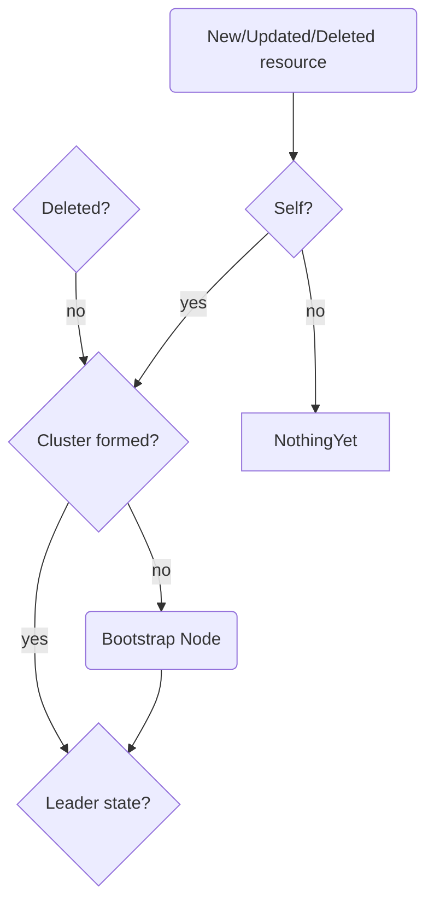

# Controller Design

The controller is designed around EndpointSlice resources.
It's a standard resource that is usually managed by Kubernetes controllers, but _can_ be self-managed.
Usually a Service creates an EndpointSlice, but that behavior can be turned off by creating the Service without a label selector.
Multiple EndpointSlices can be part of the same Service.
This makes it a good standard resource to build a controller around.
A custom resource may be introduced in the future if needed.

Every Cascade node manages its own EndpointSlice (ES).
It's responsible for creating the ES, and keeping it up-to-date.

Controllers reconcile on a specific resource type, and there is one controller for every node.
Every node thus receives every EndpointSlice.
Nodes must be able to detect if an ES belongs to itself or not, and make different decisions based on that.
That leads to the first conditional: **Does this EndpointSlice belong to me?**
If it does, the node should make sure that it's up-to-date.

In order to form a cluster, every Raft node has to be bootstrapped with peer information, including itself.
There's the second conditional: **Has this node been bootstrapped?**
If not, the peer information should be extracted from the EndpointSlice and bootstrapped into the node.
This peer information is received through the reconciliation of EndpointSlices from other nodes.
After this, the reconciliation should probably return, because nothing else should be done until a cluster is formed.

If no cluster was yet formed, all the bootstrapped nodes will find each other and hold elections.
If a cluster was already formed, a new node is still bootstrapped with all peer information.
But a node that is already part of the cluster must propose adding the new peer to the cluster.
This should only happen once, and only when a cluster is already formed, so we can rely on the cluster's leader election.
There's another conditional: **Am I the cluster leader?**
If yes, the node should propose adding the new peer.

Node shutdown/removal should also be handled.
Following the standard controller pattern, each EndpointSlice should have a finalizer to block removal of the ES when it gets deleted.
That reveals another conditional: **Is the EndpointSlice being deleted?**
The cluster leader should process a deleted ES and remove its peer from the cluster.
That removed peer might be itself, but Raft supports that.
The finalizer should then be removed from the EndpointSlice.

Cluster formation works as follows:

1. Node is started.
2. Node is bootstrapped with all known peers, including itself.
3. 

